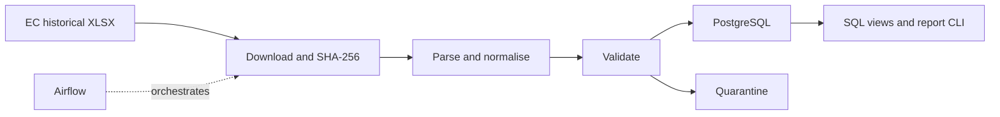

# European Fuel Price Intelligence

**Status:** Day 1 foundation; not yet an operational ingestion pipeline.

A local data engineering project for analysing historical EU retail fuel prices and tax-inclusive/exclusive differences. It uses public European Commission Weekly Oil Bulletin data, not employer or proprietary data.

## Planned solution

MVP: Eurosuper 95 and automotive diesel, national observations, both tax bases; historical and weekly ingestion, provenance, repeat-safe database writes, reconciliation, reporting and measured query plans. No forecasts, live station prices or cloud infrastructure.

## Acceptance criteria (planned, not yet passed)

- Same source interval and checksum ingested twice: no duplicate canonical keys; accepted/rejected counts reconcile.
- A changed source file can update corrected prices while retaining auditable provenance.
- Invalid dates, prices, units and market/product identifiers are quarantined with reasons.
- Tax comparisons match same date/country/product and compatible units; missing pairs remain missing.
- Weekly changes use exactly seven-day comparisons; gaps are not silently treated as weekly changes.
- Local DAG smoke/backfill and fixture end-to-end tests pass; report outputs and EXPLAIN ANALYZE evidence are recorded.

See [architecture](docs/architecture.md), [data sources](docs/data-sources.md) and [development log](docs/development-log.md). Source attribution: European Union, European Commission, DG Energy, Weekly Oil Bulletin (linked in data sources). Code licence decision deferred until release review.
